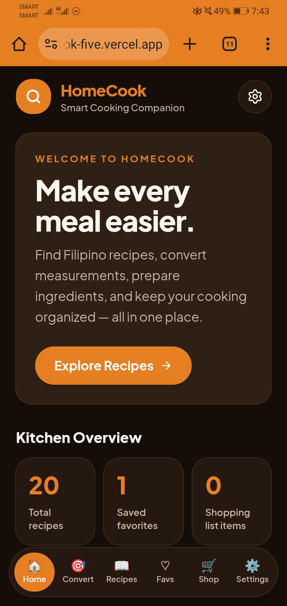

# HomeCook - Smart Cooking Companion

A simple mobile web app for home cooks. Find Filipino recipes, convert measurements, save favorites, manage shopping list, and use a cooking timer.

## Features
- Home page with Kitchen Overview
- 20 Filipino Recipes with Search and Filter
- Recipe Details with Ingredients and Cooking Timer
- Unit Converter - Cup, Tablespoon, Teaspoon, Grams, ml
- Save Favorites for Recipes and Conversions
- Shopping List - Add, Delete, Clear All
- Settings - Dark Mode / Light Mode, Profile, Clear Data

## How to Install and Run
1. Open Live Demo in your browser: https://homecook-five.vercel.app
2. Or download the code, open index.html in your browser
3. On mobile Chrome, tap 3 dots > Add to Home Screen to install as app

## Live Demo
https://homecook-five.vercel.app

## GitHub Repository
https://github.com/BlesseryPumaras/HomeCook

## Author
Blessery Joy H.Pumaras

Section:BSINTE 2A

## Screenshots

